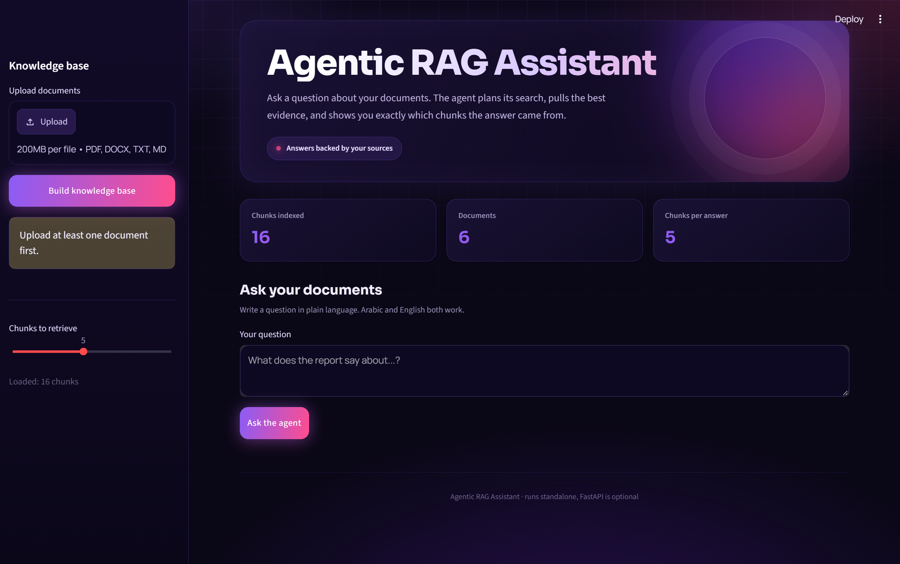
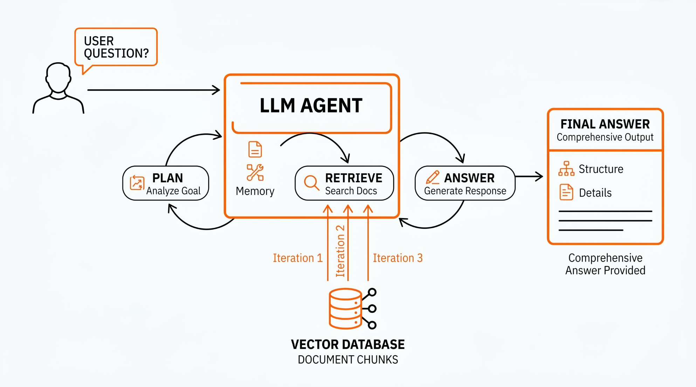
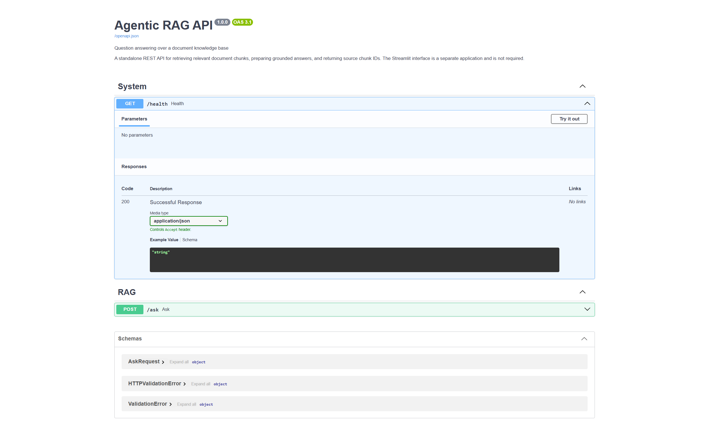

# 🤖 Agentic RAG System – AgentEval Benchmark


An **Agentic Retrieval-Augmented Generation (RAG)** project built around the **AgentEval Part I: Grounded RAG Benchmark**. It includes a Kaggle notebook for retrieval evaluation, a standalone Streamlit application for document question answering, and an optional FastAPI service.

> **Run the Streamlit application independently. FastAPI is optional and is not required by the Streamlit interface.**

---

## 🌐 Links

- 📓 **Kaggle Notebook:** [Agentic RAG System – AgentEval Evaluation](https://www.kaggle.com/code/abdelazizelshourbgy/agentic-rag-system-agenteval-evaluation)
- 🚀 **Streamlit demo:** [corrective-rag-system](https://corrective-rag-project.streamlit.app/)
- 🎥 **Demo Video:** https://github.com/user-attachments/assets/1ebef0d6-b970-4bb1-aac1-5cecf07ab2f6
## 📸 Demo

### Streamlit Application

<p align="center">
  
</p>

### Agentic RAG Workflow

<p align="center">
  
</p>

*Note: This is an illustrative workflow diagram. The current local implementation uses TF-IDF retrieval, a rule-based planner, and extractive answer preparation; it does not currently implement an LLM agent or a vector database.*

### FastAPI Documentation

<p align="center">
  
</p>

### Demo Video

A recorded walkthrough will be added here:

**Demo video link:** Add your YouTube or hosted video URL here after uploading the recording.

---

## ✨ Features

- Loads the AgentEval corpus and question datasets in the Kaggle evaluation notebook.
- Retrieves relevant knowledge chunks using TF-IDF and cosine similarity.
- Creates a simple rule-based agent plan before preparing an answer.
- Returns source chunk IDs alongside the answer.
- Evaluates retrieval using Recall@K, Precision@K, and Mean Reciprocal Rank (MRR).
- Supports PDF, DOCX, TXT, and Markdown document uploads in Streamlit.
- Builds a local chunk-based knowledge base from uploaded documents.
- Runs Streamlit without starting FastAPI.
- Provides an optional REST API with Swagger UI and ReDoc documentation.

## 🗂️ Dataset

This project uses **AgentEval Part I: Grounded RAG Benchmark**.

| File | Description |
|---|---|
| `corpus.csv` | Knowledge base split into text chunks |
| `train.csv` | Questions with reference answers and gold chunk IDs |
| `test.csv` | Questions used for evaluation/inference |
| `sample_submission.csv` | Example output structure |

Dataset sizes observed in the Kaggle notebook:

| Dataset | Rows |
|---|---:|
| Corpus | 3,600 |
| Train | 2,200 |
| Test | 800 |

The benchmark dataset is hosted on Kaggle and is **not included** in this GitHub repository. Download or attach the dataset through Kaggle when running the notebook.

## 🧠 Method

```text
User Question / Uploaded Documents
              |
              v
       Text Extraction
              |
              v
      Text Cleaning & Chunking
              |
              v
        TF-IDF Indexing
              |
              v
        Agent Planning
              |
              v
       Relevant Retrieval
              |
              v
     Evidence-Based Answer
              |
              v
       Source Chunk IDs
```

| Step | Description |
|---|---|
| Load | Read benchmark CSV files or user-uploaded documents |
| Extract | Extract text from PDF, DOCX, TXT, and Markdown files |
| Clean | Normalize whitespace and remove empty text |
| Chunk | Split document text into overlapping word chunks |
| Index | Build a TF-IDF index using unigrams and bigrams |
| Retrieve | Rank chunks using cosine similarity |
| Plan | Select a simple retrieval workflow based on the question |
| Answer | Prepare an extractive response from the retrieved passages |
| Cite | Return the chunk IDs used as evidence |

**Implementation note:** The current repository is a transparent baseline. Its planner is rule-based and its answer preparation is extractive; it does not claim to use an LLM. The Kaggle notebook is used for benchmark retrieval evaluation, while the Streamlit app is a separate document-question-answering interface.

---

## 📊 Evaluation

The Kaggle notebook evaluates retrieval against the gold chunk IDs in the training data.

| Metric | Description |
|---|---|
| Recall@5 | Proportion of relevant gold chunks found in the top five retrieved results |
| Precision@5 | Proportion of the top five retrieved results that are relevant |
| MRR | Mean reciprocal rank of the first relevant result |

Run the evaluation cells in the Kaggle notebook to calculate the actual scores. No fixed score is reported here because the values depend on the executed notebook and retrieval settings.

---

## 🖥️ Applications

### 1. Streamlit – Standalone Web Application

The Streamlit app directly imports the shared RAG pipeline from `rag_core.py`.

It supports:
- Uploading PDF, DOCX, TXT, and Markdown files.
- Building a knowledge base from uploaded documents.
- Asking questions about the uploaded content.
- Viewing the answer, retrieval plan, and source chunks.

### 2. FastAPI – Optional REST API

FastAPI exposes the RAG pipeline through HTTP endpoints. It is a separate service and is not a dependency of the Streamlit interface.

| Endpoint | Method | Description |
|---|---|---|
| `/` | GET | API landing page |
| `/health` | GET | Service and knowledge-base status |
| `/ask` | POST | Ask a question and receive an answer with source information |
| `/docs` | GET | Swagger API documentation |
| `/redoc` | GET | ReDoc API documentation |

---

## 📁 Project Structure

```text
agentic-rag-system/
│
├── assets/
│   ├── dashboard.png
│   ├── architecture.png
│   └── api-docs.png
│
├── data/
│   └── uploads/
│       └── .gitkeep
│
├── notebooks/
│   └── Agentic_RAG_Evaluation.ipynb
│
├── app.py                  # Standalone Streamlit application
├── api.py                  # Optional FastAPI service
├── rag_core.py             # Shared retrieval and answer pipeline
├── requirements.txt
├── README.md
├── LICENSE
└── .gitignore
```

Uploaded documents and generated local data are not committed to the repository.

---

## ⚙️ Installation

Clone the repository:

```bash
git clone YOUR_GITHUB_REPOSITORY_URL
cd agentic-rag-system
```

Create and activate a virtual environment.

**Windows**
```bash
python -m venv venv
venv\Scripts\activate
```

**macOS / Linux**
```bash
python -m venv venv
source venv/bin/activate
```

Install the dependencies:

```bash
pip install -r requirements.txt
```

## 🚀 Run Streamlit (Standalone)

```bash
streamlit run app.py
```

Open the local URL displayed in the terminal, usually:

```text
http://localhost:8501
```

Upload your documents from the sidebar, build the knowledge base, and ask questions. **You do not need to start FastAPI.**

## ⚡ Run FastAPI (Optional)

Start the API in a separate terminal:

```bash
uvicorn api:app --reload
```

Available local URLs:

- API landing page: `http://127.0.0.1:8000`
- Swagger UI: `http://127.0.0.1:8000/docs`
- ReDoc: `http://127.0.0.1:8000/redoc`

The API expects a compatible `data/corpus.csv` knowledge base. The Streamlit application and FastAPI service can be run separately.

---

## 🔮 Future Improvements

- Integrate an LLM for more fluent grounded answer generation.
- Add dense vector retrieval and hybrid search.
- Add a cross-encoder reranker.
- Improve multi-step question decomposition and tool selection.
- Evaluate answer faithfulness and citation accuracy.
- Add conversation history and memory.
- Deploy the Streamlit app and FastAPI service independently.

## 🛠️ Tech Stack

Python · Pandas · Scikit-learn · TF-IDF · Streamlit · FastAPI · Kaggle

## 💻 Author

**Abdelaziz Elshourbgy**

- GitHub: [@AbdelazizElshourbgy-ui](https://github.com/AbdelazizElshourbgy-ui)
- Kaggle: [abdelazizelshourbgy](https://www.kaggle.com/abdelazizelshourbgy)

## 📄 License

This project is licensed under the MIT License. See `LICENSE` for details.
